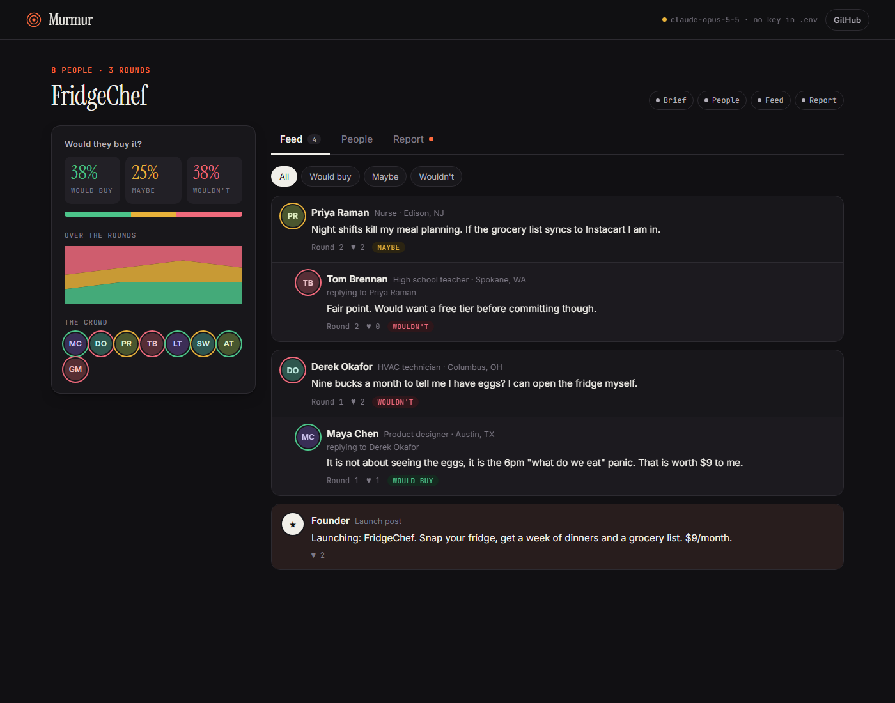
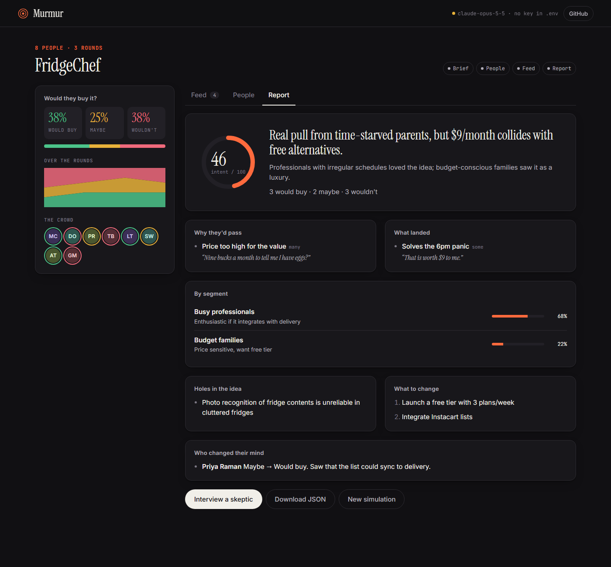

<div align="center">

# Murmur

**Drop your startup idea into a simulated society of AI people and find out if they'd actually buy it.**

[](https://github.com/Ahmed8881/murmur/actions/workflows/ci.yml)
[](LICENSE)




</div>

Paste an idea or upload a pitch deck. Murmur:

1. **Reads it** and writes a neutral product brief with realistic customer segments.
2. **Builds a crowd** of AI people with their own age, job, budget, values and personality.
3. **Drops them into a social feed.** They post, reply, like, argue, and change their minds over several rounds. Each one keeps private notes between rounds.
4. **Writes a report:** purchase intent, objections with verbatim quotes, holes in the idea, what to change, and who changed their mind and why.
5. **Lets you interview anyone.** Pull any persona aside and ask why they would or wouldn't buy.

Then go further:

- **Ask the crowd.** Put one question to everyone ("what's the most you'd pay?") and see the answers grouped by who would buy.
- **Test a variant on the same crowd.** Change the price or positioning and rerun it on the exact same people. The report shows the score change and who changed their mind.
- **Finish early.** Seen enough? Stop the remaining turns and get the report from the discussion so far.
- **See what it costs.** A live meter shows calls, tokens and estimated dollars for every run.
- **Export.** Download the report as Markdown for Notion, Slack or docs, or the raw run as JSON.



> **A simulation, not real customers.** Murmur is useful for finding the holes in an idea before real people do. It doesn't replace talking to real users.

---

## Quick start with Claude Code (recommended)

You need [Node.js 20.12+](https://nodejs.org), [Claude Code](https://claude.com/claude-code), and an [Anthropic API key](https://console.anthropic.com/settings/keys).

```bash
git clone https://github.com/Ahmed8881/murmur.git
cd murmur
claude
```

Then type:

```
/setup
```

Claude Code installs everything, creates your `.env`, checks that it is git-ignored, runs the tests, and starts the app. When it asks for your key, **paste it into the `.env` file in your editor, not into the chat.**

Open **http://127.0.0.1:3000**.

## Manual setup

```bash
git clone https://github.com/Ahmed8881/murmur.git
cd murmur
npm install
cp .env.example .env        # then put your key after ANTHROPIC_API_KEY=
npm run dev
```

Already logged in with the [`ant` CLI](https://docs.anthropic.com) (`ant auth login`)? Skip the key: the SDK picks up your profile automatically.

### Configuration (`.env`)

| Variable | Default | What it does |
|---|---|---|
| `ANTHROPIC_API_KEY` | – | Your key. Never commit it. |
| `CLAUDE_MODEL` | `claude-opus-5-5` | Model for every call. `claude-sonnet-5-5` is cheaper. |
| `PORT` | `3000` | Port. |
| `HOST` | `127.0.0.1` | Keep it local. See [SECURITY.md](SECURITY.md) before changing it. |

## What it costs

Every run uses **your** Anthropic account. A run makes about `people × rounds + a few` calls, and the form shows the exact estimate before you start. As a rough guide, 16 people × 3 rounds is about 55 calls and typically costs a dollar or two on Opus. Start with 8 people × 2 rounds while you try it out.

## How it works

```
idea / PDF ──► brief + segments ──► personas (parallel, per segment)
                                          │
                     ┌────────────────────┘
                     ▼
     rounds: personas act in shuffled waves of 6, so later waves
     see and react to earlier posts; each keeps private memory
                     │
                     ▼
     report (structured) ──► interviews (in character, with memory)
```

- Every model call uses **structured outputs** (zod schemas), so the UI never parses free text.
- Live progress streams to the browser over **Server-Sent Events**.
- Finished runs are saved to `./data/` (git-ignored) and listed under *Past simulations*.

| Path | Purpose |
|---|---|
| `src/engine.ts` | Prompts, schemas, and the simulation pipeline |
| `src/server.ts` | API, validation, SSE, security headers |
| `src/claude.ts` | Anthropic SDK wrapper |
| `public/` | Frontend (no framework, no build step) |

## Security

- Your key lives only in your local `.env` (git-ignored) or environment.
- The server listens on `127.0.0.1` only, with request validation and a strict CSP.
- Model output is rendered as plain text, never as HTML.
- The repo runs secret scanning, push protection, Dependabot and CI on every PR.

See [SECURITY.md](SECURITY.md) to report a vulnerability.

## Contributing

PRs welcome. See [CONTRIBUTING.md](CONTRIBUTING.md). Quickest way in: clone, run `claude`, type `/setup`.

## License

[MIT](LICENSE)
